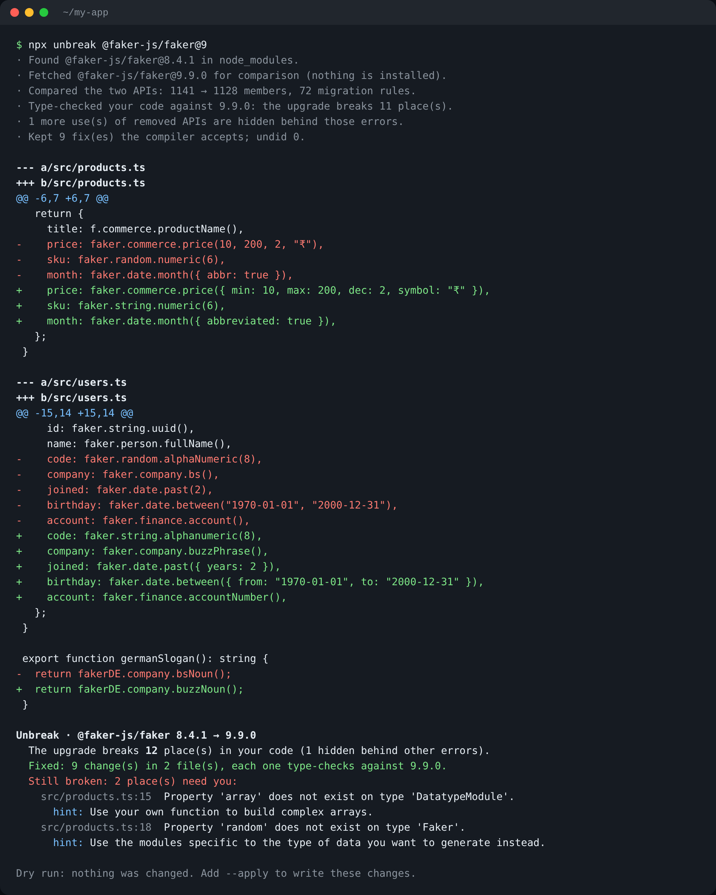

<div align="center">

# Unbreak

**Upgrade a library. Unbreak fixes the code the upgrade breaks, and proves every fix with the TypeScript compiler.**

[](https://github.com/jay-m007/unbreak/actions/workflows/ci.yml)
[](LICENSE)




</div>

## The problem

A library ships a new major version. Functions are renamed, arguments become options objects, old calls disappear.
Dependabot and Renovate bump the version number and leave the rest to you. Codemods exist for a handful of big
frameworks. AI agents will happily write a call to a function that does not exist.

So upgrades get postponed for months, and projects sit on old, unpatched versions.

## What Unbreak does

```
npx unbreak @faker-js/faker@9            # dry run: shows the diff, changes nothing
npx unbreak @faker-js/faker@9 --apply    # writes the fixes and bumps package.json
```

1. **Compares the two versions' APIs** from their type definitions. Nothing is installed; the new version is
   fetched into a cache and "overlaid" on `node_modules` in memory.
2. **Finds what actually breaks** by type-checking your untouched code against the new version.
3. **Rewrites only those places**, following the library's own `@deprecated` notes
   ("Use `faker.string.numeric()` instead"). It reads those notes from the newest release of the major you're on,
   because that is where libraries usually add them.
4. **Type-checks again and undoes anything the compiler rejects.** If the library suggested more than one
   replacement, it tries the next one first.
5. **Tells you what's left**, with the library's note for each place it could not fix, and flags fixes that
   compile but return a different type, so you can look at them.

Everything is found through the TypeScript type checker, not text search, so aliases (`const f = faker`),
renamed imports and other instances (`fakerDE.company.bs()`) are handled.

### The kinds of rewrite

| Change in the library | Example | Your code becomes |
|---|---|---|
| Member moved or renamed | `faker.random.numeric(6)` | `faker.string.numeric(6)` |
| Positional arguments replaced by an options object | `faker.date.between("1970-01-01", "2000-12-31")` | `faker.date.between({ from: "1970-01-01", to: "2000-12-31" })` |
| Option renamed | `faker.date.month({ abbr: true })` | `faker.date.month({ abbreviated: true })` |
| Export renamed | `import { makeClient } from "lib"` | `import { createClient as makeClient } from "lib"` |
| Renamed with the same signature, no note | `client.closeConnection(true)` | `client.disconnect(true)` (names must also look alike) |
| Removed, no replacement | `faker.datatype.array()` | left for you, with the library's note |

## Results on real projects

Tested on **46 public GitHub projects** that pin faker 8, found by searching GitHub for calls that faker 9 removed
([list](bench/faker-8-repos.txt), [raw results](bench/results/faker-8-to-9.json), [how to re-run](bench/README.md)).

| | |
|---|---|
| Projects the upgrade breaks | 36 of 46 |
| Places it breaks | 119 |
| **Fixed automatically** | **110 (92%)**, each one type-checked against faker 9 |
| Projects left with nothing to fix by hand | 29 of 36 |
| Fixes flagged to check by eye (return type changed) | 2 |
| Attempts the compiler rejected and Unbreak undid | 5 |
| Left for a person, with the library's note | 9 |
| Time per project (median) | 15 s |

The 9 left over are real gaps: `datatype.datetime({ min, max })` (the new `date.between` wants `{ from, to }`, which
nothing in faker's notes says), the removed `image.unsplash` module, `datatype.number` with `precision`, and a
changed `phone.number` format argument.

An early version of the benchmark caught a bad guess: `internet.avatar()` was renamed to `internet.jwtAlgorithm()`
because both are `() => string`. It compiled. Same-signature renames now also need similar names, and `@deprecated`
notes are read from the newest 8.x release, which says `internet.avatar` moved to `image.avatar`.

**Checked with real installs too.** For 6 of these projects, all dependencies were installed, Unbreak was run with
`--apply`, the real faker 9 was installed, and the project's own `tsc` was run:

| Project | `tsc` errors on faker 8 | faker 9, code untouched | faker 9 after Unbreak |
|---|---|---|---|
| xaviervamanda/WannaBet | 34 | 58 | **34** |
| NocerGal/Blog---From-Adam-to-Deve | 28 | 32 | **28** |
| Gudaites/mycareforce-back | 15 | 21 | **15** |
| SukumDecha/fullstack-nextjs | 11 | 13 | **11** |
| htmlacademy-react/1535715-six-cities-14 | 0 | 6 | **0** |
| KelySaina/faker-data (app config) | 10 | 14, with 2 old errors hidden by new ones | **10** |

In every case Unbreak brought the error count back to exactly where it was before the upgrade. The remaining
errors were already there (for example, Prisma clients that were never generated).

## Options

```
unbreak <package>[@version] [options]
unbreak diff <package> <from> <to>      list API changes between two versions

--project <dir>    project folder (default: current folder)
--apply            write the changes (default is a dry run)
--deprecations     also update deprecated calls that still work
--test "<cmd>"     after --apply, install and run this command; undo everything if it fails
--report <file>    write a Markdown report (works as a pull request description)
--json             machine-readable result
```

Exit codes: `0` nothing left to do, `2` some places need a person, `1` error.

## Honest limits

- **Types prove shape, not behaviour.** If a function keeps its name but changes what it does
  (faker's `number.int()` has a larger default range than `datatype.number()` had), no type check can see it.
  Run your tests: `--test "npm test"` does that and rolls everything back if they fail.
- **Only what the library documents.** Rules come from `@deprecated` notes, matching signatures and
  hand-written [recipes](CONTRIBUTING.md#adding-a-recipe). A change with none of those is reported, not fixed.
- **Through-a-variable uses are reported, not rewritten.** `const r = faker.random; r.word()` is listed for you.
- **JavaScript projects** are analysed with `checkJs`, which sees less than a typed project.
- **`@types/*` libraries** (e.g. yargs) work when `@types/<name>` is installed: Unbreak compares it with the
  matching `@types` release (same major.minor, else same major) and bumps both packages. Sub-path imports
  (`pkg/sub`) in `@types` packages are not read yet. Real-world check: ws 7 → 8 breaks `new WebSocket.Server()`
  (now a named export, `WebSocketServer`); Unbreak finds the break but can't fix it yet, because that needs a new
  import added, which it doesn't do.
- Tested deeply on one library so far (faker). Other libraries work through the same engine but need their own
  testing; please open an issue with results.

## On Renovate / Dependabot PRs

[`examples/unbreak-on-dependency-prs.yml`](examples/unbreak-on-dependency-prs.yml) is a GitHub Actions workflow: when a bot bumps a library, it runs Unbreak on the PR branch, pushes the compiler-checked fixes, and comments the report. It is an untested starting point; adjust the install step to your package manager.

## How it's built

TypeScript, run directly by Node's type stripping, with one runtime dependency: the TypeScript compiler API.
No AI calls: every rewrite is deterministic and repeatable.

```
src/surface.ts   package .d.ts  →  map of public paths, signatures, @deprecated notes
src/rules.ts     old surface + new surface  →  rename / to-object / option / removed rules
src/usages.ts    project + checker  →  every use, with exact text edits
src/project.ts   tsconfig, programs, the in-memory overlay of the new version
src/migrate.ts   find breaks → fix → re-check → undo rejected → report
```

See [CONTRIBUTING.md](CONTRIBUTING.md) to add a recipe or a new kind of rewrite.

## Licence

MIT © Jay Maurya
